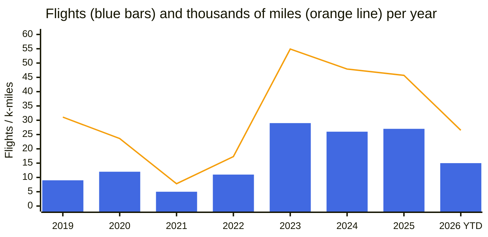
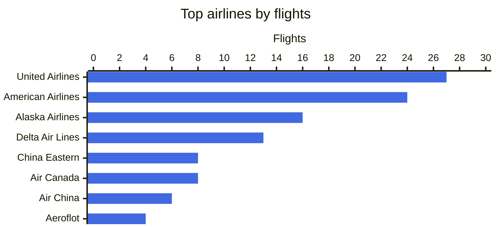

# About Me ✨


<h1 align="center">
  
</h1>

<p align="center">
Hi, I'm <b>Helio</b> — based at <b>EWR</b>, from <b>Shanghai</b>.<br/>
I log every flight I take. Here's what <b>134 of them</b> look like, from July 2019 to today.
</p>

<p align="center">
  
  
  
  
  
  
</p>

<p align="center">
  <a href="#stats">📊 Stats</a> &nbsp;·&nbsp; <a href="#charts">📈 Charts</a> &nbsp;·&nbsp; <a href="#map">🗺️ Route map</a> &nbsp;·&nbsp; <a href="#trivia">🎲 Trivia</a> &nbsp;·&nbsp; <a href="#upcoming">✨ Upcoming</a> &nbsp;·&nbsp; <a href="#logbook">📒 Logbook</a> &nbsp;·&nbsp; <a href="#connect">☁️ Connect</a>
</p>

<a name="stats"></a>

## ✈️ My Aviation Stats & Facts ✈️

| Category | Details |
|----------|---------|
| 🌎 **Current Base** | EWR (Northern NJ) |
| 🏠 **Home Airports** | PVG/SHA (Shanghai) |
| 🧮 **Lifetime** | 134 flights · 254,891 mi · ~599 block hours (≈25 days) |
| ⚡ **Shortest Flight** | AS 65 KTN→WRG · 82 mi (the Alaska “milk run”) |
| 🛫 **Longest Flight** |  UA 60 SFO→MEL · 7,863 mi · 15h 56m |
| 💺 **Top Airlines** |  United Airlines (27)<br> American Airlines (24)<br>Alaska Airlines (16)<br> Delta Air Lines (13) |
| 📍 **Most-Visited Airport** | ORD (Chicago O'Hare) · 32 visits |
| 🔁 **Most-Flown Route** | ORD ⇄ SEA · 6 times |
| 🛩️ **Most-Flown Aircraft** | Boeing 737-800 · 22 flights (29 types in total) |
| ⏱️ **On-Time Arrivals** | 78% within 15 min of schedule |
| 🧭 **Farthest North / South** | ANC (61.2°N) / MEL (37.7°S) |

**Countries visited (16):** 🇦🇺 🇨🇦 🇨🇳 🇫🇷 🇩🇪 🇭🇰 🇮🇪 🇮🇹 🇯🇵 🇲🇽 🇶🇦 🇷🇺 🇰🇷 🇨🇭 🇬🇧 🇺🇸

<details>
<summary><b>🛩️ The hangar</b>: every aircraft type I've flown</summary>

| Aircraft | Flights |
|----------|--------:|
| Boeing 737-800 | 22 |
| Boeing 777-300 ER | 13 |
| Boeing 737-700 | 11 |
| Embraer 175 | 10 |
| Boeing 737-900ER | 9 |
| Boeing 787-9 | 8 |
| Airbus A321 | 7 |
| Airbus A350-900 | 7 |
| Airbus A320 | 5 |
| Airbus A330-200 | 4 |
| Bombardier CRJ200 | 4 |
| Airbus A321neo | 4 |
| Boeing 737 MAX 9 | 4 |
| Boeing 787-8 | 3 |
| Bombardier CRJ900 | 3 |
| Airbus A330-300 | 3 |
| Boeing 787-10 | 2 |
| Airbus A319 | 2 |
| Airbus A350-1000 | 2 |
| Boeing 737 MAX 8 | 2 |
| Boeing 757-300 | 1 |
| Boeing 767-300 | 1 |
| DHC-8-400 Dash 8Q | 1 |
| Airbus A340-300 | 1 |
| Airbus A330-900neo | 1 |
| Boeing 717-200 | 1 |
| Embraer 170 | 1 |
| Boeing 777-200 ER | 1 |
| Airbus A320neo | 1 |

</details>

<details>
<summary><b>📍 Airport leaderboard</b>: 64 airports and counting</summary>

| # | Airport | City | Visits |
|--:|---------|------|-------:|
| 1 | **ORD** | Chicago 🇺🇸 | 32 |
| 2 | **PVG** | Shanghai 🇨🇳 | 23 |
| 3 | **SEA** | Seattle 🇺🇸 | 20 |
| 4 | **CLE** | Cleveland 🇺🇸 | 19 |
| 5 | **SHA** | Shanghai 🇨🇳 | 15 |
| 6 | **EWR** | Newark 🇺🇸 | 11 |
| 7 | **YVR** | Richmond 🇨🇦 | 8 |
| 8 | **SFO** | San Francisco 🇺🇸 | 6 |
| 9 | **ICN** | Seoul 🇰🇷 | 5 |
| 10 | **SVO** | Moscow 🇷🇺 | 4 |

Also: ANC · BDL · BNE · BOS · CAN · CDG · CLT · CMH · CTU · DCA · DEN · DFW · DOH · DTW · DUB · FCO · FOC · HAK · HKG · HND · IAD · IAH · JFK · JNU · KMG · KTN · LAS · LGA · LGW · MEL · MEX · MIA · MUC · NKG · NRT · OAK · OGG · OMA · PDX · PEK · PHL · PIT · PKX · RDU · SJU · SLC · SYD · SYX · SZX · TYN · WRG · XNN · YYZ · ZRH

</details>

<details>
<summary><b>💺 All 24 airlines</b></summary>

| Airline | Flights | Miles |
|---------|--------:|------:|
|  United Airlines (UA) | 27 | 57,300 |
|  American Airlines (AA) | 24 | 30,527 |
| Alaska Airlines (AS) | 16 | 19,092 |
|  Delta Air Lines (DL) | 13 | 31,540 |
| China Eastern (MU) | 8 | 7,468 |
| Air Canada (AC) | 8 | 20,771 |
| Air China (CA) | 6 | 14,338 |
| Aeroflot (SU) | 4 | 11,529 |
| Cathay Pacific (CX) | 4 | 13,907 |
| Qatar Airways (QR) | 2 | 10,729 |
| ANA (NH) | 2 | 8,109 |
| China Southern (CZ) | 2 | 2,283 |
| Virgin Australia (VA) | 2 | 1,326 |
| Aer Lingus (EI) | 2 | 3,758 |
| Juneyao Air (HO) | 2 | 1,892 |
| Shenzhen Airlines (ZH) | 2 | 1,429 |
| SWISS (LX) | 2 | 10,043 |
| Southwest (WN) | 2 | 1,344 |
| WestJet (WS) | 1 | 3,566 |
| Xiamen Air (MF) | 1 | 378 |
| Japan Airlines (JL) | 1 | 1,104 |
| Shanghai Airlines (FM) | 1 | 751 |
| Tibet Airlines (TV) | 1 | 1,015 |
| Spring Airlines (9C) | 1 | 693 |

</details>

<a name="charts"></a>

## 📈 By the Numbers







<a name="map"></a>

## 🗺️ Route Map

Every route I've flown. Click a line or a pin for details, and zoom or drag to explore. Purple marks a route that's booked but not flown yet. <sub>([Open the map full-screen](flight-map.geojson))</sub>

```geojson
{"type":"FeatureCollection","features":[
{"type":"Feature","properties":{"route":"EWR ⇄ ICN","status":"booked for Dec 2026","distance":"6,881 mi","stroke":"#a855f7","stroke-width":2.5,"stroke-opacity":0.9},"geometry":{"type":"MultiLineString","coordinates":[[[-74.17,40.69],[-76.42,45.98],[-79.15,51.21],[-82.57,56.36],[-87.05,61.39],[-93.21,66.21],[-102.15,70.68],[-115.69,74.48],[-135.85,77.01],[-161.02,77.48],[-180,75.97]],[[180,75.97],[176.26,75.67],[160.28,72.28],[149.8,68.03],[142.71,63.32],[137.66,58.36],[133.88,53.25],[130.91,48.04],[128.49,42.78],[126.45,37.47]]]}},
{"type":"Feature","properties":{"route":"KTN ⇄ WRG","flown":"1×","distance":"82 mi","airlines":"AS ×1","stroke":"#4169E1","stroke-width":2.1,"stroke-opacity":0.75},"geometry":{"type":"LineString","coordinates":[[-131.71,55.35],[-132.04,55.92],[-132.37,56.48]]}},
{"type":"Feature","properties":{"route":"CLE ⇄ DTW","flown":"1×","distance":"95 mi","airlines":"DL ×1","stroke":"#4169E1","stroke-width":2.1,"stroke-opacity":0.75},"geometry":{"type":"LineString","coordinates":[[-81.85,41.41],[-82.6,41.81],[-83.35,42.21]]}},
{"type":"Feature","properties":{"route":"JNU ⇄ WRG","flown":"1×","distance":"153 mi","airlines":"AS ×1","stroke":"#4169E1","stroke-width":2.1,"stroke-opacity":0.75},"geometry":{"type":"LineString","coordinates":[[-134.58,58.35],[-133.45,57.42],[-132.37,56.48]]}},
{"type":"Feature","properties":{"route":"BOS ⇄ JFK","flown":"1×","distance":"186 mi","airlines":"DL ×1","stroke":"#4169E1","stroke-width":2.1,"stroke-opacity":0.75},"geometry":{"type":"LineString","coordinates":[[-71.01,42.36],[-72.41,41.51],[-73.78,40.64]]}},
{"type":"Feature","properties":{"route":"CLE ⇄ YYZ","flown":"1×","distance":"193 mi","airlines":"AC ×1","stroke":"#4169E1","stroke-width":2.1,"stroke-opacity":0.75},"geometry":{"type":"LineString","coordinates":[[-81.85,41.41],[-80.76,42.55],[-79.63,43.68]]}},
{"type":"Feature","properties":{"route":"DCA ⇄ PIT","flown":"1×","distance":"204 mi","airlines":"AA ×1","stroke":"#4169E1","stroke-width":2.1,"stroke-opacity":0.75},"geometry":{"type":"LineString","coordinates":[[-77.04,38.85],[-78.62,39.68],[-80.23,40.49]]}},
{"type":"Feature","properties":{"route":"DCA ⇄ LGA","flown":"1×","distance":"214 mi","airlines":"AA ×1","stroke":"#4169E1","stroke-width":2.1,"stroke-opacity":0.75},"geometry":{"type":"LineString","coordinates":[[-77.04,38.85],[-75.48,39.83],[-73.87,40.78]]}},
{"type":"Feature","properties":{"route":"PIT ⇄ YYZ","flown":"1×","distance":"222 mi","airlines":"AC ×1","stroke":"#4169E1","stroke-width":2.1,"stroke-opacity":0.75},"geometry":{"type":"LineString","coordinates":[[-80.23,40.49],[-79.94,42.08],[-79.63,43.68]]}},
{"type":"Feature","properties":{"route":"DTW ⇄ ORD","flown":"1×","distance":"234 mi","airlines":"DL ×1","stroke":"#4169E1","stroke-width":2.1,"stroke-opacity":0.75},"geometry":{"type":"LineString","coordinates":[[-83.35,42.21],[-85.64,42.12],[-87.91,41.98]]}},
{"type":"Feature","properties":{"route":"CLE ⇄ IAD","flown":"1×","distance":"288 mi","airlines":"UA ×1","stroke":"#4169E1","stroke-width":2.1,"stroke-opacity":0.75},"geometry":{"type":"LineString","coordinates":[[-81.85,41.41],[-79.62,40.2],[-77.46,38.95]]}},
{"type":"Feature","properties":{"route":"CMH ⇄ ORD","flown":"1×","distance":"295 mi","airlines":"AA ×1","stroke":"#4169E1","stroke-width":2.1,"stroke-opacity":0.75},"geometry":{"type":"LineString","coordinates":[[-82.89,40.0],[-85.36,41.01],[-87.91,41.98]]}},
{"type":"Feature","properties":{"route":"DUB ⇄ LGW","flown":"1×","distance":"301 mi","airlines":"EI ×1","stroke":"#4169E1","stroke-width":2.1,"stroke-opacity":0.75},"geometry":{"type":"LineString","coordinates":[[-6.27,53.42],[-3.15,52.32],[-0.19,51.15]]}},
{"type":"Feature","properties":{"route":"CLE ⇄ PHL","flown":"1×","distance":"363 mi","airlines":"AA ×1","stroke":"#4169E1","stroke-width":2.1,"stroke-opacity":0.75},"geometry":{"type":"LineString","coordinates":[[-81.85,41.41],[-78.51,40.69],[-75.24,39.87]]}},
{"type":"Feature","properties":{"route":"FOC ⇄ SHA","flown":"1×","distance":"378 mi","airlines":"MF ×1","stroke":"#4169E1","stroke-width":2.1,"stroke-opacity":0.75},"geometry":{"type":"LineString","coordinates":[[119.66,25.94],[120.48,28.57],[121.34,31.2]]}},
{"type":"Feature","properties":{"route":"ORD ⇄ PIT","flown":"1×","distance":"412 mi","airlines":"UA ×1","stroke":"#4169E1","stroke-width":2.1,"stroke-opacity":0.75},"geometry":{"type":"LineString","coordinates":[[-87.91,41.98],[-84.03,41.3],[-80.23,40.49]]}},
{"type":"Feature","properties":{"route":"LAS ⇄ SFO","flown":"1×","distance":"413 mi","airlines":"UA ×1","stroke":"#4169E1","stroke-width":2.1,"stroke-opacity":0.75},"geometry":{"type":"LineString","coordinates":[[-115.15,36.08],[-118.73,36.9],[-122.38,37.62]]}},
{"type":"Feature","properties":{"route":"SYX ⇄ SZX","flown":"1×","distance":"413 mi","airlines":"ZH ×1","stroke":"#4169E1","stroke-width":2.1,"stroke-opacity":0.75},"geometry":{"type":"LineString","coordinates":[[109.41,18.3],[111.58,20.48],[113.81,22.64]]}},
{"type":"Feature","properties":{"route":"OMA ⇄ ORD","flown":"1×","distance":"415 mi","airlines":"AA ×1","stroke":"#4169E1","stroke-width":2.1,"stroke-opacity":0.75},"geometry":{"type":"LineString","coordinates":[[-95.89,41.3],[-91.92,41.71],[-87.91,41.98]]}},
{"type":"Feature","properties":{"route":"CLE ⇄ CLT","flown":"1×","distance":"431 mi","airlines":"AA ×1","stroke":"#4169E1","stroke-width":2.1,"stroke-opacity":0.75},"geometry":{"type":"LineString","coordinates":[[-81.85,41.41],[-81.38,38.31],[-80.95,35.21]]}},
{"type":"Feature","properties":{"route":"CLT ⇄ PHL","flown":"1×","distance":"449 mi","airlines":"AA ×1","stroke":"#4169E1","stroke-width":2.1,"stroke-opacity":0.75},"geometry":{"type":"LineString","coordinates":[[-80.95,35.21],[-78.19,37.58],[-75.24,39.87]]}},
{"type":"Feature","properties":{"route":"BNE ⇄ SYD","flown":"1×","distance":"468 mi","airlines":"VA ×1","stroke":"#4169E1","stroke-width":2.1,"stroke-opacity":0.75},"geometry":{"type":"LineString","coordinates":[[153.12,-27.38],[152.18,-30.67],[151.18,-33.95]]}},
{"type":"Feature","properties":{"route":"BOS ⇄ CLE","flown":"1×","distance":"562 mi","airlines":"DL ×1","stroke":"#4169E1","stroke-width":2.1,"stroke-opacity":0.75},"geometry":{"type":"LineString","coordinates":[[-71.01,42.36],[-76.47,42.01],[-81.85,41.41]]}},
{"type":"Feature","properties":{"route":"KTN ⇄ SEA","flown":"1×","distance":"679 mi","airlines":"AS ×1","stroke":"#4169E1","stroke-width":2.1,"stroke-opacity":0.75},"geometry":{"type":"LineString","coordinates":[[-131.71,55.35],[-126.6,51.5],[-122.31,47.45]]}},
{"type":"Feature","properties":{"route":"SEA ⇄ SLC","flown":"1×","distance":"688 mi","airlines":"DL ×1","stroke":"#4169E1","stroke-width":2.1,"stroke-opacity":0.75},"geometry":{"type":"LineString","coordinates":[[-122.31,47.45],[-116.85,44.24],[-111.98,40.79]]}},
{"type":"Feature","properties":{"route":"PVG ⇄ TYN","flown":"1×","distance":"693 mi","airlines":"9C ×1","stroke":"#4169E1","stroke-width":2.1,"stroke-opacity":0.75},"geometry":{"type":"LineString","coordinates":[[121.81,31.14],[117.4,34.53],[112.63,37.75]]}},
{"type":"Feature","properties":{"route":"IAH ⇄ MEX","flown":"1×","distance":"765 mi","airlines":"UA ×1","stroke":"#4169E1","stroke-width":2.1,"stroke-opacity":0.75},"geometry":{"type":"LineString","coordinates":[[-95.34,29.98],[-97.29,24.72],[-99.07,19.44]]}},
{"type":"Feature","properties":{"route":"BNE ⇄ MEL","flown":"1×","distance":"858 mi","airlines":"VA ×1","stroke":"#4169E1","stroke-width":2.1,"stroke-opacity":0.75},"geometry":{"type":"LineString","coordinates":[[153.12,-27.38],[150.56,-30.87],[147.82,-34.31],[144.84,-37.67]]}},
{"type":"Feature","properties":{"route":"JNU ⇄ SEA","flown":"1×","distance":"907 mi","airlines":"AS ×1","stroke":"#4169E1","stroke-width":2.1,"stroke-opacity":0.75},"geometry":{"type":"LineString","coordinates":[[-134.58,58.35],[-129.77,54.87],[-125.74,51.22],[-122.31,47.45]]}},
{"type":"Feature","properties":{"route":"IAH ⇄ ORD","flown":"1×","distance":"926 mi","airlines":"UA ×1","stroke":"#4169E1","stroke-width":2.1,"stroke-opacity":0.75},"geometry":{"type":"LineString","coordinates":[[-95.34,29.98],[-93.11,34.03],[-90.65,38.03],[-87.91,41.98]]}},
{"type":"Feature","properties":{"route":"MIA ⇄ PHL","flown":"1×","distance":"1,015 mi","airlines":"AA ×1","stroke":"#4169E1","stroke-width":2.1,"stroke-opacity":0.75},"geometry":{"type":"LineString","coordinates":[[-80.29,25.8],[-78.78,30.51],[-77.11,35.2],[-75.24,39.87]]}},
{"type":"Feature","properties":{"route":"MIA ⇄ SJU","flown":"1×","distance":"1,045 mi","airlines":"AA ×1","stroke":"#4169E1","stroke-width":2.1,"stroke-opacity":0.75},"geometry":{"type":"LineString","coordinates":[[-80.29,25.8],[-75.36,23.49],[-70.6,21.03],[-66.0,18.44]]}},
{"type":"Feature","properties":{"route":"HAK ⇄ PVG","flown":"1×","distance":"1,047 mi","airlines":"CZ ×1","stroke":"#4169E1","stroke-width":2.1,"stroke-opacity":0.75},"geometry":{"type":"LineString","coordinates":[[110.46,19.93],[114.01,23.76],[117.78,27.51],[121.81,31.14]]}},
{"type":"Feature","properties":{"route":"HND ⇄ SHA","flown":"1×","distance":"1,104 mi","airlines":"JL ×1","stroke":"#4169E1","stroke-width":2.1,"stroke-opacity":0.75},"geometry":{"type":"LineString","coordinates":[[139.78,35.55],[133.43,34.41],[127.27,32.95],[121.34,31.2]]}},
{"type":"Feature","properties":{"route":"DEN ⇄ YVR","flown":"1×","distance":"1,112 mi","airlines":"UA ×1","stroke":"#4169E1","stroke-width":2.1,"stroke-opacity":0.75},"geometry":{"type":"LineString","coordinates":[[-104.67,39.86],[-110.19,43.29],[-116.34,46.43],[-123.18,49.19]]}},
{"type":"Feature","properties":{"route":"NRT ⇄ PVG","flown":"1×","distance":"1,116 mi","airlines":"NH ×1","stroke":"#4169E1","stroke-width":2.1,"stroke-opacity":0.75},"geometry":{"type":"LineString","coordinates":[[140.39,35.76],[133.97,34.54],[127.77,32.99],[121.81,31.14]]}},
{"type":"Feature","properties":{"route":"CAN ⇄ PKX","flown":"1×","distance":"1,128 mi","airlines":"CA ×1","stroke":"#4169E1","stroke-width":2.1,"stroke-opacity":0.75},"geometry":{"type":"LineString","coordinates":[[113.3,23.39],[114.22,28.77],[115.24,34.14],[116.4,39.5]]}},
{"type":"Feature","properties":{"route":"SHA ⇄ SYX","flown":"1×","distance":"1,162 mi","airlines":"HO ×1","stroke":"#4169E1","stroke-width":2.1,"stroke-opacity":0.75},"geometry":{"type":"LineString","coordinates":[[121.34,31.2],[117.07,27.01],[113.12,22.7],[109.41,18.3]]}},
{"type":"Feature","properties":{"route":"PVG ⇄ SYX","flown":"1×","distance":"1,178 mi","airlines":"MU ×1","stroke":"#4169E1","stroke-width":2.1,"stroke-opacity":0.75},"geometry":{"type":"LineString","coordinates":[[121.81,31.14],[117.38,26.98],[113.27,22.69],[109.41,18.3]]}},
{"type":"Feature","properties":{"route":"CLE ⇄ DEN","flown":"1×","distance":"1,198 mi","airlines":"UA ×1","stroke":"#4169E1","stroke-width":2.1,"stroke-opacity":0.75},"geometry":{"type":"LineString","coordinates":[[-81.85,41.41],[-89.56,41.4],[-97.2,40.88],[-104.67,39.86]]}},
{"type":"Feature","properties":{"route":"KMG ⇄ SHA","flown":"1×","distance":"1,210 mi","airlines":"MU ×1","stroke":"#4169E1","stroke-width":2.1,"stroke-opacity":0.75},"geometry":{"type":"LineString","coordinates":[[102.74,24.99],[107.19,26.77],[111.77,28.41],[116.49,29.89],[121.34,31.2]]}},
{"type":"Feature","properties":{"route":"KMG ⇄ PVG","flown":"1×","distance":"1,235 mi","airlines":"CZ ×1","stroke":"#4169E1","stroke-width":2.1,"stroke-opacity":0.75},"geometry":{"type":"LineString","coordinates":[[102.74,24.99],[107.3,26.77],[112.0,28.4],[116.83,29.86],[121.81,31.14]]}},
{"type":"Feature","properties":{"route":"OMA ⇄ SEA","flown":"1×","distance":"1,364 mi","airlines":"AS ×1","stroke":"#4169E1","stroke-width":2.1,"stroke-opacity":0.75},"geometry":{"type":"LineString","coordinates":[[-95.89,41.3],[-101.95,43.39],[-108.4,45.14],[-115.21,46.51],[-122.31,47.45]]}},
{"type":"Feature","properties":{"route":"FCO ⇄ SVO","flown":"1×","distance":"1,490 mi","airlines":"SU ×1","stroke":"#4169E1","stroke-width":2.1,"stroke-opacity":0.75},"geometry":{"type":"LineString","coordinates":[[12.25,41.8],[17.26,45.81],[23.01,49.56],[29.68,52.98],[37.41,55.97]]}},
{"type":"Feature","properties":{"route":"LAS ⇄ ORD","flown":"1×","distance":"1,511 mi","airlines":"UA ×1","stroke":"#4169E1","stroke-width":2.1,"stroke-opacity":0.75},"geometry":{"type":"LineString","coordinates":[[-115.15,36.08],[-108.8,38.14],[-102.11,39.83],[-95.12,41.12],[-87.91,41.98]]}},
{"type":"Feature","properties":{"route":"CDG ⇄ SVO","flown":"1×","distance":"1,525 mi","airlines":"SU ×1","stroke":"#4169E1","stroke-width":2.1,"stroke-opacity":0.75},"geometry":{"type":"LineString","coordinates":[[2.55,49.01],[10.13,51.67],[18.56,53.78],[27.73,55.24],[37.41,55.97]]}},
{"type":"Feature","properties":{"route":"PHL ⇄ SJU","flown":"1×","distance":"1,580 mi","airlines":"AA ×1","stroke":"#4169E1","stroke-width":2.1,"stroke-opacity":0.75},"geometry":{"type":"LineString","coordinates":[[-75.24,39.87],[-72.52,34.58],[-70.13,29.23],[-67.98,23.85],[-66.0,18.44]]}},
{"type":"Feature","properties":{"route":"ORD ⇄ PDX","flown":"1×","distance":"1,734 mi","airlines":"AS ×1","stroke":"#4169E1","stroke-width":2.1,"stroke-opacity":0.75},"geometry":{"type":"LineString","coordinates":[[-87.91,41.98],[-94.41,43.53],[-101.22,44.69],[-108.25,45.43],[-115.41,45.74],[-122.6,45.59]]}},
{"type":"Feature","properties":{"route":"ORD ⇄ YVR","flown":"1×","distance":"1,759 mi","airlines":"AA ×1","stroke":"#4169E1","stroke-width":2.1,"stroke-opacity":0.75},"geometry":{"type":"LineString","coordinates":[[-87.91,41.98],[-94.15,44.25],[-100.86,46.16],[-107.99,47.65],[-115.47,48.67],[-123.18,49.19]]}},
{"type":"Feature","properties":{"route":"EWR ⇄ SLC","flown":"1×","distance":"1,964 mi","airlines":"DL ×1","stroke":"#4169E1","stroke-width":2.1,"stroke-opacity":0.75},"geometry":{"type":"LineString","coordinates":[[-74.17,40.69],[-81.6,41.71],[-89.22,42.24],[-96.9,42.26],[-104.53,41.77],[-111.98,40.79]]}},
{"type":"Feature","properties":{"route":"CMH ⇄ SEA","flown":"1×","distance":"2,011 mi","airlines":"AS ×1","stroke":"#4169E1","stroke-width":2.1,"stroke-opacity":0.75},"geometry":{"type":"LineString","coordinates":[[-82.89,40.0],[-88.67,42.14],[-94.82,43.97],[-101.32,45.45],[-108.13,46.54],[-115.16,47.21],[-122.31,47.45]]}},
{"type":"Feature","properties":{"route":"IAD ⇄ SEA","flown":"1×","distance":"2,300 mi","airlines":"UA ×1","stroke":"#4169E1","stroke-width":2.1,"stroke-opacity":0.75},"geometry":{"type":"LineString","coordinates":[[-77.46,38.95],[-83.9,41.52],[-90.84,43.7],[-98.24,45.44],[-106.03,46.67],[-114.11,47.35],[-122.31,47.45]]}},
{"type":"Feature","properties":{"route":"CLE ⇄ DUB","flown":"1×","distance":"3,457 mi","airlines":"EI ×1","stroke":"#4169E1","stroke-width":2.1,"stroke-opacity":0.75},"geometry":{"type":"LineString","coordinates":[[-81.85,41.41],[-75.94,44.92],[-69.3,48.09],[-61.85,50.82],[-53.57,53.03],[-44.53,54.61],[-34.94,55.46],[-25.12,55.55],[-15.45,54.85],[-6.27,53.42]]}},
{"type":"Feature","properties":{"route":"LGW ⇄ YYZ","flown":"1×","distance":"3,566 mi","airlines":"WS ×1","stroke":"#4169E1","stroke-width":2.1,"stroke-opacity":0.75},"geometry":{"type":"LineString","coordinates":[[-0.19,51.15],[-8.9,53.25],[-18.36,54.66],[-28.3,55.29],[-38.35,55.1],[-48.11,54.09],[-57.24,52.35],[-65.56,49.96],[-73.01,47.03],[-79.63,43.68]]}},
{"type":"Feature","properties":{"route":"OGG ⇄ ORD","flown":"1×","distance":"4,178 mi","airlines":"UA ×1","stroke":"#4169E1","stroke-width":2.1,"stroke-opacity":0.75},"geometry":{"type":"LineString","coordinates":[[-156.43,20.9],[-151.64,24.16],[-146.61,27.27],[-141.29,30.19],[-135.67,32.88],[-129.71,35.31],[-123.4,37.42],[-116.77,39.18],[-109.83,40.55],[-102.65,41.49],[-95.3,41.97],[-87.91,41.98]]}},
{"type":"Feature","properties":{"route":"DOH ⇄ PVG","flown":"1×","distance":"4,223 mi","airlines":"QR ×1","stroke":"#4169E1","stroke-width":2.1,"stroke-opacity":0.75},"geometry":{"type":"LineString","coordinates":[[51.61,25.26],[57.37,27.33],[63.32,29.16],[69.48,30.71],[75.82,31.97],[82.31,32.9],[88.91,33.49],[95.58,33.72],[102.25,33.6],[108.88,33.12],[115.41,32.3],[121.81,31.14]]}},
{"type":"Feature","properties":{"route":"ORD ⇄ ZRH","flown":"1×","distance":"4,431 mi","airlines":"LX ×1","stroke":"#4169E1","stroke-width":2.1,"stroke-opacity":0.75},"geometry":{"type":"LineString","coordinates":[[-87.91,41.98],[-82.23,45.4],[-75.85,48.5],[-68.69,51.21],[-60.73,53.43],[-52.02,55.06],[-42.72,56.03],[-33.13,56.28],[-23.6,55.78],[-14.47,54.57],[-6.01,52.72],[1.67,50.32],[8.55,47.46]]}},
{"type":"Feature","properties":{"route":"MUC ⇄ ORD","flown":"1×","distance":"4,517 mi","airlines":"UA ×1","stroke":"#4169E1","stroke-width":2.1,"stroke-opacity":0.75},"geometry":{"type":"LineString","coordinates":[[11.79,48.35],[4.74,51.37],[-3.21,53.91],[-12.06,55.87],[-21.67,57.13],[-31.75,57.61],[-41.86,57.28],[-51.59,56.16],[-60.6,54.33],[-68.73,51.89],[-75.94,48.96],[-82.29,45.62],[-87.91,41.98]]}},
{"type":"Feature","properties":{"route":"HKG ⇄ SYD","flown":"1×","distance":"4,594 mi","airlines":"CX ×1","stroke":"#4169E1","stroke-width":2.1,"stroke-opacity":0.75},"geometry":{"type":"LineString","coordinates":[[113.92,22.31],[117.1,17.64],[120.12,12.93],[123.02,8.18],[125.86,3.41],[128.67,-1.36],[131.49,-6.14],[134.37,-10.9],[137.33,-15.63],[140.44,-20.31],[143.74,-24.94],[147.29,-29.5],[151.18,-33.95]]}},
{"type":"Feature","properties":{"route":"ICN ⇄ YVR","flown":"1×","distance":"5,095 mi","airlines":"AC ×1","stroke":"#4169E1","stroke-width":2.1,"stroke-opacity":0.75},"geometry":{"type":"MultiLineString","coordinates":[[[126.45,37.47],[131.3,41.74],[136.82,45.78],[143.17,49.51],[150.5,52.84],[158.95,55.65],[168.53,57.79],[179.08,59.14],[180,59.17]],[[-180,59.17],[-169.81,59.57],[-158.73,59.05],[-148.25,57.63],[-138.77,55.42],[-130.42,52.56],[-123.18,49.19]]]}},
{"type":"Feature","properties":{"route":"MUC ⇄ PVG","flown":"1×","distance":"5,455 mi","airlines":"CA ×1","stroke":"#4169E1","stroke-width":2.1,"stroke-opacity":0.75},"geometry":{"type":"LineString","coordinates":[[11.79,48.35],[19.19,51.36],[27.54,53.84],[36.79,55.67],[46.75,56.74],[57.07,56.99],[67.29,56.39],[76.99,54.99],[85.87,52.87],[93.83,50.16],[100.85,46.96],[107.05,43.39],[112.52,39.52],[117.41,35.42],[121.81,31.14]]}},
{"type":"Feature","properties":{"route":"PVG ⇄ YVR","flown":"1×","distance":"5,602 mi","airlines":"AC ×1","stroke":"#4169E1","stroke-width":2.1,"stroke-opacity":0.75},"geometry":{"type":"MultiLineString","coordinates":[[[121.81,31.14],[125.78,35.41],[130.19,39.53],[135.14,43.47],[140.76,47.16],[147.18,50.53],[154.53,53.51],[162.88,55.96],[172.2,57.79],[180,58.62]],[[-180,58.62],[-177.7,58.86],[-167.21,59.11],[-156.82,58.52],[-147.01,57.12],[-138.07,55.03],[-130.14,52.34],[-123.18,49.19]]]}},
{"type":"Feature","properties":{"route":"PVG ⇄ ZRH","flown":"1×","distance":"5,612 mi","airlines":"LX ×1","stroke":"#4169E1","stroke-width":2.1,"stroke-opacity":0.75},"geometry":{"type":"LineString","coordinates":[[121.81,31.14],[117.64,35.29],[113.03,39.28],[107.88,43.06],[102.08,46.58],[95.51,49.77],[88.09,52.54],[79.77,54.79],[70.61,56.41],[60.83,57.3],[50.79,57.41],[40.9,56.72],[31.55,55.29],[23.0,53.19],[15.34,50.55],[8.55,47.46]]}},
{"type":"Feature","properties":{"route":"LGW ⇄ PVG","flown":"1×","distance":"5,749 mi","airlines":"CA ×1","stroke":"#4169E1","stroke-width":2.1,"stroke-opacity":0.75},"geometry":{"type":"LineString","coordinates":[[-0.19,51.15],[6.84,54.74],[15.13,57.84],[24.81,60.31],[35.8,61.98],[47.66,62.69],[59.68,62.37],[71.07,61.05],[81.28,58.87],[90.09,55.99],[97.59,52.57],[103.94,48.75],[109.35,44.63],[114.04,40.28],[118.15,35.78],[121.81,31.14]]}},
{"type":"Feature","properties":{"route":"PVG ⇄ SFO","flown":"1×","distance":"6,138 mi","airlines":"UA ×1","stroke":"#4169E1","stroke-width":2.1,"stroke-opacity":0.75},"geometry":{"type":"MultiLineString","coordinates":[[[121.81,31.14],[126.63,34.95],[131.92,38.54],[137.74,41.87],[144.16,44.88],[151.25,47.48],[159.0,49.61],[167.36,51.18],[176.18,52.12],[180,52.23]],[[-180,52.23],[-174.75,52.38],[-165.73,51.94],[-157.0,50.83],[-148.79,49.11],[-141.21,46.84],[-134.31,44.12],[-128.05,41.02],[-122.38,37.62]]]}},
{"type":"Feature","properties":{"route":"DFW ⇄ HND","flown":"1×","distance":"6,449 mi","airlines":"AA ×1","stroke":"#4169E1","stroke-width":2.1,"stroke-opacity":0.75},"geometry":{"type":"MultiLineString","coordinates":[[[-97.04,32.9],[-101.71,36.83],[-106.88,40.55],[-112.64,44.02],[-119.07,47.17],[-126.26,49.91],[-134.23,52.16],[-142.93,53.82],[-152.2,54.8],[-161.75,55.05],[-171.24,54.55],[-180,53.39]],[[180,53.39],[179.65,53.34],[171.18,51.48],[163.46,49.06],[156.53,46.17],[150.33,42.91],[144.78,39.35],[139.78,35.55]]]}},
{"type":"Feature","properties":{"route":"BOS ⇄ DOH","flown":"1×","distance":"6,506 mi","airlines":"QR ×1","stroke":"#4169E1","stroke-width":2.1,"stroke-opacity":0.75},"geometry":{"type":"LineString","coordinates":[[-71.01,42.36],[-64.94,45.78],[-58.12,48.84],[-50.49,51.45],[-42.04,53.51],[-32.87,54.92],[-23.21,55.59],[-13.42,55.49],[-3.86,54.62],[5.15,53.04],[13.39,50.83],[20.81,48.1],[27.43,44.94],[33.32,41.43],[38.59,37.66],[43.33,33.68],[47.64,29.54],[51.61,25.26]]}},
{"type":"Feature","properties":{"route":"ICN ⇄ YYZ","flown":"1×","distance":"6,597 mi","airlines":"AC ×1","stroke":"#4169E1","stroke-width":2.1,"stroke-opacity":0.75},"geometry":{"type":"MultiLineString","coordinates":[[[126.45,37.47],[128.89,42.77],[131.79,48.0],[135.33,53.15],[139.83,58.16],[145.77,62.97],[153.95,67.43],[165.57,71.29],[180,73.78]],[[-180,73.78],[-178.0,74.12],[-157.05,75.31],[-135.64,74.46],[-118.32,71.87],[-105.95,68.15],[-97.27,63.77],[-91.01,59.01],[-86.31,54.03],[-82.62,48.9],[-79.63,43.68]]]}},
{"type":"Feature","properties":{"route":"DTW ⇄ ICN","flown":"1×","distance":"6,620 mi","airlines":"DL ×1","stroke":"#4169E1","stroke-width":2.1,"stroke-opacity":0.75},"geometry":{"type":"MultiLineString","coordinates":[[[-83.35,42.21],[-86.65,47.34],[-90.64,52.36],[-95.65,57.2],[-102.12,61.79],[-110.74,65.97],[-122.4,69.49],[-137.82,71.96],[-156.32,72.92],[-174.97,72.12],[-180,71.36]],[[180,71.36],[169.28,69.76],[157.3,66.32],[148.44,62.18],[141.82,57.62],[136.7,52.8],[132.63,47.79],[129.28,42.67],[126.45,37.47]]]}},
{"type":"Feature","properties":{"route":"MEX ⇄ NRT","flown":"1×","distance":"6,993 mi","airlines":"NH ×1","stroke":"#4169E1","stroke-width":2.1,"stroke-opacity":0.75},"geometry":{"type":"MultiLineString","coordinates":[[[-99.07,19.44],[-103.43,23.33],[-108.05,27.09],[-112.98,30.69],[-118.29,34.1],[-124.02,37.25],[-130.22,40.11],[-136.94,42.61],[-144.16,44.68],[-151.86,46.27],[-159.93,47.31],[-168.24,47.77],[-176.59,47.62],[-180,47.32]],[[180,47.32],[175.19,46.88],[167.28,45.57],[159.81,43.74],[152.83,41.45],[146.36,38.77],[140.39,35.76]]]}},
{"type":"Feature","properties":{"route":"DTW ⇄ PVG","flown":"1×","distance":"7,122 mi","airlines":"DL ×1","stroke":"#4169E1","stroke-width":2.1,"stroke-opacity":0.75},"geometry":{"type":"MultiLineString","coordinates":[[[-83.35,42.21],[-86.52,47.48],[-90.38,52.65],[-95.25,57.65],[-101.65,62.41],[-110.35,66.77],[-122.43,70.46],[-138.85,73.03],[-158.84,73.94],[-178.7,72.92],[-180,72.7]],[[180,72.7],[165.15,70.26],[153.31,66.52],[144.78,62.13],[138.49,57.36],[133.69,52.34],[129.88,47.17],[126.75,41.89],[124.11,36.54],[121.81,31.14]]]}},
{"type":"Feature","properties":{"route":"DFW ⇄ PVG","flown":"1×","distance":"7,337 mi","airlines":"AA ×1","stroke":"#4169E1","stroke-width":2.1,"stroke-opacity":0.75},"geometry":{"type":"MultiLineString","coordinates":[[[-97.04,32.9],[-100.97,37.47],[-105.41,41.9],[-110.49,46.13],[-116.39,50.1],[-123.31,53.71],[-131.43,56.86],[-140.88,59.39],[-151.6,61.14],[-163.22,61.96],[-175.08,61.77],[-180,61.25]],[[180,61.25],[173.57,60.58],[163.3,58.52],[154.36,55.74],[146.71,52.4],[140.2,48.64],[134.63,44.56],[129.81,40.25],[125.58,35.76],[121.81,31.14]]]}},
{"type":"Feature","properties":{"route":"HKG ⇄ ORD","flown":"1×","distance":"7,781 mi","airlines":"CX ×1","stroke":"#4169E1","stroke-width":2.1,"stroke-opacity":0.75},"geometry":{"type":"MultiLineString","coordinates":[[[113.92,22.31],[115.82,27.67],[117.91,33.0],[120.28,38.3],[123.02,43.53],[126.27,48.69],[130.26,53.74],[135.33,58.62],[141.98,63.24],[151.03,67.43],[163.54,70.91],[180,73.2]],[[-180,73.2],[-179.71,73.24],[-159.85,73.9],[-140.61,72.7],[-125.13,69.97],[-113.77,66.24],[-105.54,61.9],[-99.43,57.19],[-94.73,52.25],[-90.99,47.16],[-87.91,41.98]]]}},
{"type":"Feature","properties":{"route":"MEL ⇄ SFO","flown":"1×","distance":"7,863 mi","airlines":"UA ×1","stroke":"#4169E1","stroke-width":2.1,"stroke-opacity":0.75},"geometry":{"type":"MultiLineString","coordinates":[[[144.84,-37.67],[150.83,-34.66],[156.37,-31.38],[161.53,-27.87],[166.36,-24.19],[170.91,-20.36],[175.23,-16.42],[179.39,-12.4],[180,-11.77]],[[-180,-11.77],[-176.59,-8.31],[-172.65,-4.18],[-168.74,-0.04],[-164.84,4.11],[-160.9,8.23],[-156.88,12.32],[-152.73,16.35],[-148.4,20.29],[-143.86,24.12],[-139.04,27.81],[-133.89,31.31],[-128.35,34.6],[-122.38,37.62]]]}},
{"type":"Feature","properties":{"route":"SEA ⇄ YVR","flown":"2×","distance":"127 mi","airlines":"AC ×1, AS ×1","stroke":"#4169E1","stroke-width":2.7,"stroke-opacity":0.75},"geometry":{"type":"LineString","coordinates":[[-122.31,47.45],[-122.74,48.32],[-123.18,49.19]]}},
{"type":"Feature","properties":{"route":"BDL ⇄ IAD","flown":"2×","distance":"325 mi","airlines":"UA ×2","stroke":"#4169E1","stroke-width":2.7,"stroke-opacity":0.75},"geometry":{"type":"LineString","coordinates":[[-72.68,41.94],[-75.13,40.47],[-77.46,38.95]]}},
{"type":"Feature","properties":{"route":"CLE ⇄ EWR","flown":"2×","distance":"403 mi","airlines":"UA ×2","stroke":"#4169E1","stroke-width":2.7,"stroke-opacity":0.75},"geometry":{"type":"LineString","coordinates":[[-81.85,41.41],[-77.99,41.11],[-74.17,40.69]]}},
{"type":"Feature","properties":{"route":"CLE ⇄ JFK","flown":"2×","distance":"424 mi","airlines":"DL ×1, AA ×1","stroke":"#4169E1","stroke-width":2.7,"stroke-opacity":0.75},"geometry":{"type":"LineString","coordinates":[[-81.85,41.41],[-77.79,41.1],[-73.78,40.64]]}},
{"type":"Feature","properties":{"route":"ICN ⇄ PVG","flown":"2×","distance":"511 mi","airlines":"DL ×1, AC ×1","stroke":"#4169E1","stroke-width":2.7,"stroke-opacity":0.75},"geometry":{"type":"LineString","coordinates":[[126.45,37.47],[124.04,34.33],[121.81,31.14]]}},
{"type":"Feature","properties":{"route":"ANC ⇄ JNU","flown":"2×","distance":"569 mi","airlines":"AS ×2","stroke":"#4169E1","stroke-width":2.7,"stroke-opacity":0.75},"geometry":{"type":"LineString","coordinates":[[-150.0,61.17],[-141.96,59.99],[-134.58,58.35]]}},
{"type":"Feature","properties":{"route":"DCA ⇄ ORD","flown":"2×","distance":"611 mi","airlines":"AA ×2","stroke":"#4169E1","stroke-width":2.7,"stroke-opacity":0.75},"geometry":{"type":"LineString","coordinates":[[-77.04,38.85],[-82.35,40.54],[-87.91,41.98]]}},
{"type":"Feature","properties":{"route":"ORD ⇄ RDU","flown":"2×","distance":"646 mi","airlines":"AA ×2","stroke":"#4169E1","stroke-width":2.7,"stroke-opacity":0.75},"geometry":{"type":"LineString","coordinates":[[-87.91,41.98],[-83.15,39.02],[-78.79,35.88]]}},
{"type":"Feature","properties":{"route":"OAK ⇄ SEA","flown":"2×","distance":"672 mi","airlines":"WN ×2","stroke":"#4169E1","stroke-width":2.7,"stroke-opacity":0.75},"geometry":{"type":"LineString","coordinates":[[-122.22,37.72],[-122.26,42.59],[-122.31,47.45]]}},
{"type":"Feature","properties":{"route":"HKG ⇄ SHA","flown":"2×","distance":"766 mi","airlines":"CX ×2","stroke":"#4169E1","stroke-width":2.7,"stroke-opacity":0.75},"geometry":{"type":"LineString","coordinates":[[113.92,22.31],[117.48,26.8],[121.34,31.2]]}},
{"type":"Feature","properties":{"route":"NKG ⇄ XNN","flown":"2×","distance":"1,015 mi","airlines":"TV ×1, ZH ×1","stroke":"#4169E1","stroke-width":2.7,"stroke-opacity":0.75},"geometry":{"type":"LineString","coordinates":[[118.86,31.74],[113.47,33.59],[107.86,35.19],[102.04,36.53]]}},
{"type":"Feature","properties":{"route":"CLE ⇄ DFW","flown":"2×","distance":"1,020 mi","airlines":"AA ×2","stroke":"#4169E1","stroke-width":2.7,"stroke-opacity":0.75},"geometry":{"type":"LineString","coordinates":[[-81.85,41.41],[-87.3,38.79],[-92.35,35.94],[-97.04,32.9]]}},
{"type":"Feature","properties":{"route":"CTU ⇄ PVG","flown":"2×","distance":"1,059 mi","airlines":"MU ×2","stroke":"#4169E1","stroke-width":2.7,"stroke-opacity":0.75},"geometry":{"type":"LineString","coordinates":[[103.95,30.58],[109.87,31.04],[115.83,31.23],[121.81,31.14]]}},
{"type":"Feature","properties":{"route":"CLE ⇄ SEA","flown":"2×","distance":"2,015 mi","airlines":"AS ×2","stroke":"#4169E1","stroke-width":2.7,"stroke-opacity":0.75},"geometry":{"type":"LineString","coordinates":[[-81.85,41.41],[-87.88,43.37],[-94.27,45.0],[-100.99,46.25],[-107.97,47.09],[-115.12,47.49],[-122.31,47.45]]}},
{"type":"Feature","properties":{"route":"EWR ⇄ YVR","flown":"2×","distance":"2,423 mi","airlines":"AC ×1, UA ×1","stroke":"#4169E1","stroke-width":2.7,"stroke-opacity":0.75},"geometry":{"type":"LineString","coordinates":[[-74.17,40.69],[-80.06,43.11],[-86.41,45.21],[-93.2,46.93],[-100.37,48.22],[-107.85,49.04],[-115.51,49.37],[-123.18,49.19]]}},
{"type":"Feature","properties":{"route":"PVG ⇄ SVO","flown":"2×","distance":"4,257 mi","airlines":"SU ×2","stroke":"#4169E1","stroke-width":2.7,"stroke-opacity":0.75},"geometry":{"type":"LineString","coordinates":[[121.81,31.14],[117.46,35.41],[112.63,39.5],[107.23,43.36],[101.11,46.94],[94.17,50.15],[86.31,52.89],[77.51,55.04],[67.88,56.5],[57.71,57.16],[47.4,56.98],[37.41,55.97]]}},
{"type":"Feature","properties":{"route":"PVG ⇄ SEA","flown":"2×","distance":"5,709 mi","airlines":"DL ×2","stroke":"#4169E1","stroke-width":2.7,"stroke-opacity":0.75},"geometry":{"type":"MultiLineString","coordinates":[[[121.81,31.14],[125.95,35.43],[130.55,39.55],[135.72,43.48],[141.58,47.14],[148.26,50.45],[155.88,53.33],[164.48,55.66],[174.01,57.32],[180,57.84]],[[-180,57.84],[-175.79,58.2],[-165.32,58.24],[-155.07,57.43],[-145.47,55.84],[-136.78,53.57],[-129.07,50.73],[-122.31,47.45]]]}},
{"type":"Feature","properties":{"route":"EWR ⇄ PVG","flown":"2×","distance":"7,370 mi","airlines":"UA ×2","stroke":"#4169E1","stroke-width":2.7,"stroke-opacity":0.75},"geometry":{"type":"MultiLineString","coordinates":[[[-74.17,40.69],[-76.16,46.12],[-78.58,51.5],[-81.65,56.82],[-85.72,62.04],[-91.46,67.09],[-100.1,71.83],[-114.02,75.94],[-136.55,78.7],[-165.91,79.06],[-180,77.78]],[[180,77.78],[169.22,76.8],[153.42,72.94],[143.73,68.32],[137.42,63.33],[133.0,58.15],[129.72,52.85],[127.16,47.48],[125.08,42.06],[123.33,36.61],[121.81,31.14]]]}},
{"type":"Feature","properties":{"route":"CLE ⇄ ORD","flown":"3×","distance":"315 mi","airlines":"UA ×3","stroke":"#4169E1","stroke-width":3.3,"stroke-opacity":0.75},"geometry":{"type":"LineString","coordinates":[[-81.85,41.41],[-84.87,41.73],[-87.91,41.98]]}},
{"type":"Feature","properties":{"route":"PEK ⇄ SHA","flown":"3×","distance":"669 mi","airlines":"CA ×3","stroke":"#4169E1","stroke-width":3.3,"stroke-opacity":0.75},"geometry":{"type":"LineString","coordinates":[[116.58,40.08],[119.09,35.66],[121.34,31.2]]}},
{"type":"Feature","properties":{"route":"CAN ⇄ SHA","flown":"3×","distance":"730 mi","airlines":"MU ×2, HO ×1","stroke":"#4169E1","stroke-width":3.3,"stroke-opacity":0.75},"geometry":{"type":"LineString","coordinates":[[113.3,23.39],[117.18,27.35],[121.34,31.2]]}},
{"type":"Feature","properties":{"route":"SHA ⇄ SZX","flown":"3×","distance":"751 mi","airlines":"MU ×2, FM ×1","stroke":"#4169E1","stroke-width":3.3,"stroke-opacity":0.75},"geometry":{"type":"LineString","coordinates":[[121.34,31.2],[117.43,26.97],[113.81,22.64]]}},
{"type":"Feature","properties":{"route":"ORD ⇄ SFO","flown":"3×","distance":"1,842 mi","airlines":"UA ×2, AA ×1","stroke":"#4169E1","stroke-width":3.3,"stroke-opacity":0.75},"geometry":{"type":"LineString","coordinates":[[-87.91,41.98],[-95.08,41.96],[-102.2,41.49],[-109.17,40.6],[-115.91,39.29],[-122.38,37.62]]}},
{"type":"Feature","properties":{"route":"EWR ⇄ ORD","flown":"4×","distance":"718 mi","airlines":"AA ×3, UA ×1","stroke":"#4169E1","stroke-width":3.9,"stroke-opacity":0.75},"geometry":{"type":"LineString","coordinates":[[-74.17,40.69],[-80.97,41.54],[-87.91,41.98]]}},
{"type":"Feature","properties":{"route":"ORD ⇄ SEA","flown":"6×","distance":"1,716 mi","airlines":"AS ×4, UA ×1, DL ×1","stroke":"#4169E1","stroke-width":5,"stroke-opacity":0.75},"geometry":{"type":"LineString","coordinates":[[-87.91,41.98],[-94.18,43.87],[-100.82,45.4],[-107.79,46.53],[-114.99,47.22],[-122.31,47.45]]}},
{"type":"Feature","properties":{"airport":"FCO","name":"Leonardo Da Vinci (Fiumicino) International Airport","city":"Rome, Italy","visits":1,"marker-color":"#4169E1","marker-size":"small","marker-symbol":"airport"},"geometry":{"type":"Point","coordinates":[12.251,41.804]}},
{"type":"Feature","properties":{"airport":"LGA","name":"Laguardia Airport","city":"New York, United States","visits":1,"marker-color":"#4169E1","marker-size":"small","marker-symbol":"airport"},"geometry":{"type":"Point","coordinates":[-73.873,40.777]}},
{"type":"Feature","properties":{"airport":"FOC","name":"Fuzhou Changle International Airport","city":"Fuzhou, China","visits":1,"marker-color":"#4169E1","marker-size":"small","marker-symbol":"airport"},"geometry":{"type":"Point","coordinates":[119.663,25.935]}},
{"type":"Feature","properties":{"airport":"PDX","name":"Portland International Airport","city":"Portland, United States","visits":1,"marker-color":"#4169E1","marker-size":"small","marker-symbol":"airport"},"geometry":{"type":"Point","coordinates":[-122.597,45.589]}},
{"type":"Feature","properties":{"airport":"TYN","name":"Taiyuan Wusu Airport","city":"Taiyuan, China","visits":1,"marker-color":"#4169E1","marker-size":"small","marker-symbol":"airport"},"geometry":{"type":"Point","coordinates":[112.628,37.747]}},
{"type":"Feature","properties":{"airport":"CDG","name":"Charles de Gaulle International Airport","city":"Paris, France","visits":1,"marker-color":"#4169E1","marker-size":"small","marker-symbol":"airport"},"geometry":{"type":"Point","coordinates":[2.55,49.013]}},
{"type":"Feature","properties":{"airport":"HAK","name":"Haikou Meilan International Airport","city":"Haikou, China","visits":1,"marker-color":"#4169E1","marker-size":"small","marker-symbol":"airport"},"geometry":{"type":"Point","coordinates":[110.459,19.935]}},
{"type":"Feature","properties":{"airport":"OGG","name":"Kahului Airport","city":"Kahului, United States","visits":1,"marker-color":"#4169E1","marker-size":"small","marker-symbol":"airport"},"geometry":{"type":"Point","coordinates":[-156.43,20.899]}},
{"type":"Feature","properties":{"airport":"PKX","name":"Beijing Daxing International Airport","city":"Beijing, China","visits":1,"marker-color":"#4169E1","marker-size":"small","marker-symbol":"airport"},"geometry":{"type":"Point","coordinates":[116.4,39.5]}},
{"type":"Feature","properties":{"airport":"DOH","name":"Hamad International Airport","city":"Doha, Qatar","visits":2,"marker-color":"#4169E1","marker-size":"small","marker-symbol":"airport"},"geometry":{"type":"Point","coordinates":[51.614,25.261]}},
{"type":"Feature","properties":{"airport":"CTU","name":"Chengdu Shuangliu International Airport","city":"Chengdu, China","visits":2,"marker-color":"#4169E1","marker-size":"small","marker-symbol":"airport"},"geometry":{"type":"Point","coordinates":[103.947,30.578]}},
{"type":"Feature","properties":{"airport":"IAH","name":"George Bush Intcntl/Houston Airport","city":"Houston, United States","visits":2,"marker-color":"#4169E1","marker-size":"small","marker-symbol":"airport"},"geometry":{"type":"Point","coordinates":[-95.341,29.984]}},
{"type":"Feature","properties":{"airport":"MEX","name":"Licenciado Benito Juarez International Airport","city":"Mexico City, Mexico","visits":2,"marker-color":"#4169E1","marker-size":"small","marker-symbol":"airport"},"geometry":{"type":"Point","coordinates":[-99.072,19.436]}},
{"type":"Feature","properties":{"airport":"NRT","name":"Narita International Airport","city":"Tokyo, Japan","visits":2,"marker-color":"#4169E1","marker-size":"small","marker-symbol":"airport"},"geometry":{"type":"Point","coordinates":[140.386,35.765]}},
{"type":"Feature","properties":{"airport":"KMG","name":"Kunming Wujiaba International Airport","city":"Kunming, China","visits":2,"marker-color":"#4169E1","marker-size":"small","marker-symbol":"airport"},"geometry":{"type":"Point","coordinates":[102.744,24.992]}},
{"type":"Feature","properties":{"airport":"DEN","name":"Denver International Airport","city":"Denver, United States","visits":2,"marker-color":"#4169E1","marker-size":"small","marker-symbol":"airport"},"geometry":{"type":"Point","coordinates":[-104.673,39.862]}},
{"type":"Feature","properties":{"airport":"MEL","name":"Melbourne International Airport","city":"Melbourne, Australia","visits":2,"marker-color":"#4169E1","marker-size":"small","marker-symbol":"airport"},"geometry":{"type":"Point","coordinates":[144.843,-37.673]}},
{"type":"Feature","properties":{"airport":"BNE","name":"Brisbane International Airport","city":"Brisbane, Australia","visits":2,"marker-color":"#4169E1","marker-size":"small","marker-symbol":"airport"},"geometry":{"type":"Point","coordinates":[153.117,-27.384]}},
{"type":"Feature","properties":{"airport":"SYD","name":"Sydney Kingsford Smith International Airport","city":"Sydney, Australia","visits":2,"marker-color":"#4169E1","marker-size":"small","marker-symbol":"airport"},"geometry":{"type":"Point","coordinates":[151.177,-33.946]}},
{"type":"Feature","properties":{"airport":"HND","name":"Tokyo International Airport","city":"Tokyo, Japan","visits":2,"marker-color":"#4169E1","marker-size":"small","marker-symbol":"airport"},"geometry":{"type":"Point","coordinates":[139.78,35.552]}},
{"type":"Feature","properties":{"airport":"BDL","name":"Bradley International Airport","city":"Windsor Locks, United States","visits":2,"marker-color":"#4169E1","marker-size":"small","marker-symbol":"airport"},"geometry":{"type":"Point","coordinates":[-72.684,41.939]}},
{"type":"Feature","properties":{"airport":"DUB","name":"Dublin Airport","city":"Dublin, Ireland","visits":2,"marker-color":"#4169E1","marker-size":"small","marker-symbol":"airport"},"geometry":{"type":"Point","coordinates":[-6.27,53.421]}},
{"type":"Feature","properties":{"airport":"CLT","name":"Charlotte/Douglas International Airport","city":"Charlotte, United States","visits":2,"marker-color":"#4169E1","marker-size":"small","marker-symbol":"airport"},"geometry":{"type":"Point","coordinates":[-80.951,35.213]}},
{"type":"Feature","properties":{"airport":"SJU","name":"Luis Munoz Marin International Airport","city":"San Juan, United States","visits":2,"marker-color":"#4169E1","marker-size":"small","marker-symbol":"airport"},"geometry":{"type":"Point","coordinates":[-66.002,18.439]}},
{"type":"Feature","properties":{"airport":"MIA","name":"Miami International Airport","city":"Miami, United States","visits":2,"marker-color":"#4169E1","marker-size":"small","marker-symbol":"airport"},"geometry":{"type":"Point","coordinates":[-80.29,25.795]}},
{"type":"Feature","properties":{"airport":"NKG","name":"Nanjing Lukou Airport","city":"Nanjing, China","visits":2,"marker-color":"#4169E1","marker-size":"small","marker-symbol":"airport"},"geometry":{"type":"Point","coordinates":[118.862,31.742]}},
{"type":"Feature","properties":{"airport":"XNN","name":"Xining Caojiabu Airport","city":"Xining, China","visits":2,"marker-color":"#4169E1","marker-size":"small","marker-symbol":"airport"},"geometry":{"type":"Point","coordinates":[102.043,36.528]}},
{"type":"Feature","properties":{"airport":"ZRH","name":"Zurich Airport","city":"Zurich, Switzerland","visits":2,"marker-color":"#4169E1","marker-size":"small","marker-symbol":"airport"},"geometry":{"type":"Point","coordinates":[8.549,47.465]}},
{"type":"Feature","properties":{"airport":"MUC","name":"Munich International Airport","city":"Munich, Germany","visits":2,"marker-color":"#4169E1","marker-size":"small","marker-symbol":"airport"},"geometry":{"type":"Point","coordinates":[11.786,48.354]}},
{"type":"Feature","properties":{"airport":"OMA","name":"Eppley Airfield","city":"Omaha, United States","visits":2,"marker-color":"#4169E1","marker-size":"small","marker-symbol":"airport"},"geometry":{"type":"Point","coordinates":[-95.894,41.303]}},
{"type":"Feature","properties":{"airport":"OAK","name":"Oakland San Francisco Bay Airport","city":"Oakland, United States","visits":2,"marker-color":"#4169E1","marker-size":"small","marker-symbol":"airport"},"geometry":{"type":"Point","coordinates":[-122.221,37.721]}},
{"type":"Feature","properties":{"airport":"CMH","name":"John Glenn Columbus International Airport","city":"Columbus, United States","visits":2,"marker-color":"#4169E1","marker-size":"small","marker-symbol":"airport"},"geometry":{"type":"Point","coordinates":[-82.892,39.997]}},
{"type":"Feature","properties":{"airport":"KTN","name":"Ketchikan International Airport","city":"Ketchikan, United States","visits":2,"marker-color":"#4169E1","marker-size":"small","marker-symbol":"airport"},"geometry":{"type":"Point","coordinates":[-131.711,55.354]}},
{"type":"Feature","properties":{"airport":"WRG","name":"Wrangell Airport","city":"Wrangell, United States","visits":2,"marker-color":"#4169E1","marker-size":"small","marker-symbol":"airport"},"geometry":{"type":"Point","coordinates":[-132.37,56.484]}},
{"type":"Feature","properties":{"airport":"ANC","name":"Ted Stevens Anchorage International Airport","city":"Anchorage, United States","visits":2,"marker-color":"#4169E1","marker-size":"small","marker-symbol":"airport"},"geometry":{"type":"Point","coordinates":[-149.998,61.174]}},
{"type":"Feature","properties":{"airport":"LAS","name":"Harry Reid International Airport","city":"Las Vegas, United States","visits":2,"marker-color":"#4169E1","marker-size":"small","marker-symbol":"airport"},"geometry":{"type":"Point","coordinates":[-115.152,36.08]}},
{"type":"Feature","properties":{"airport":"RDU","name":"Raleigh-Durham International Airport","city":"Raleigh/Durham, United States","visits":2,"marker-color":"#4169E1","marker-size":"small","marker-symbol":"airport"},"geometry":{"type":"Point","coordinates":[-78.787,35.878]}},
{"type":"Feature","properties":{"airport":"SLC","name":"Salt Lake City International Airport","city":"Salt Lake City, United States","visits":2,"marker-color":"#4169E1","marker-size":"small","marker-symbol":"airport"},"geometry":{"type":"Point","coordinates":[-111.978,40.788]}},
{"type":"Feature","properties":{"airport":"SYX","name":"Sanya Phoenix International Airport","city":"Sanya, China","visits":3,"marker-color":"#4169E1","marker-size":"small","marker-symbol":"airport"},"geometry":{"type":"Point","coordinates":[109.412,18.303]}},
{"type":"Feature","properties":{"airport":"JFK","name":"John F Kennedy International Airport","city":"New York, United States","visits":3,"marker-color":"#4169E1","marker-size":"small","marker-symbol":"airport"},"geometry":{"type":"Point","coordinates":[-73.779,40.64]}},
{"type":"Feature","properties":{"airport":"BOS","name":"General Edward Lawrence Logan International Airport","city":"Boston, United States","visits":3,"marker-color":"#4169E1","marker-size":"small","marker-symbol":"airport"},"geometry":{"type":"Point","coordinates":[-71.006,42.363]}},
{"type":"Feature","properties":{"airport":"LGW","name":"London Gatwick Airport","city":"London, United Kingdom","visits":3,"marker-color":"#4169E1","marker-size":"small","marker-symbol":"airport"},"geometry":{"type":"Point","coordinates":[-0.19,51.148]}},
{"type":"Feature","properties":{"airport":"PIT","name":"Pittsburgh International Airport","city":"Pittsburgh, United States","visits":3,"marker-color":"#4169E1","marker-size":"small","marker-symbol":"airport"},"geometry":{"type":"Point","coordinates":[-80.233,40.491]}},
{"type":"Feature","properties":{"airport":"PEK","name":"Beijing Capital International Airport","city":"Beijing, China","visits":3,"marker-color":"#4169E1","marker-size":"small","marker-symbol":"airport"},"geometry":{"type":"Point","coordinates":[116.585,40.08]}},
{"type":"Feature","properties":{"airport":"SVO","name":"Sheremetyevo International Airport","city":"Moscow, Russia","visits":4,"marker-color":"#4169E1","marker-size":"medium","marker-symbol":"airport"},"geometry":{"type":"Point","coordinates":[37.415,55.973]}},
{"type":"Feature","properties":{"airport":"DTW","name":"Detroit Metro Wayne County Airport","city":"Detroit, United States","visits":4,"marker-color":"#4169E1","marker-size":"medium","marker-symbol":"airport"},"geometry":{"type":"Point","coordinates":[-83.353,42.212]}},
{"type":"Feature","properties":{"airport":"YYZ","name":"Toronto Pearson International Airport","city":"Mississauga, Canada","visits":4,"marker-color":"#4169E1","marker-size":"medium","marker-symbol":"airport"},"geometry":{"type":"Point","coordinates":[-79.631,43.677]}},
{"type":"Feature","properties":{"airport":"DCA","name":"Ronald Reagan Washington Ntl Airport","city":"Washington, United States","visits":4,"marker-color":"#4169E1","marker-size":"medium","marker-symbol":"airport"},"geometry":{"type":"Point","coordinates":[-77.038,38.851]}},
{"type":"Feature","properties":{"airport":"HKG","name":"Chek Lap Kok International Airport","city":"Hong Kong, Hong Kong","visits":4,"marker-color":"#4169E1","marker-size":"medium","marker-symbol":"airport"},"geometry":{"type":"Point","coordinates":[113.915,22.309]}},
{"type":"Feature","properties":{"airport":"DFW","name":"Dallas-Fort Worth International Airport","city":"Dallas-Fort Worth, United States","visits":4,"marker-color":"#4169E1","marker-size":"medium","marker-symbol":"airport"},"geometry":{"type":"Point","coordinates":[-97.038,32.897]}},
{"type":"Feature","properties":{"airport":"IAD","name":"Washington Dulles International Airport","city":"Washington, United States","visits":4,"marker-color":"#4169E1","marker-size":"medium","marker-symbol":"airport"},"geometry":{"type":"Point","coordinates":[-77.46,38.947]}},
{"type":"Feature","properties":{"airport":"CAN","name":"Guangzhou Baiyun International Airport","city":"Guangzhou, China","visits":4,"marker-color":"#4169E1","marker-size":"medium","marker-symbol":"airport"},"geometry":{"type":"Point","coordinates":[113.299,23.392]}},
{"type":"Feature","properties":{"airport":"PHL","name":"Philadelphia International Airport","city":"Philadelphia, United States","visits":4,"marker-color":"#4169E1","marker-size":"medium","marker-symbol":"airport"},"geometry":{"type":"Point","coordinates":[-75.241,39.872]}},
{"type":"Feature","properties":{"airport":"SZX","name":"Shenzhen Bao'an International Airport","city":"Shenzhen, China","visits":4,"marker-color":"#4169E1","marker-size":"medium","marker-symbol":"airport"},"geometry":{"type":"Point","coordinates":[113.811,22.639]}},
{"type":"Feature","properties":{"airport":"JNU","name":"Juneau International Airport","city":"Juneau, United States","visits":4,"marker-color":"#4169E1","marker-size":"medium","marker-symbol":"airport"},"geometry":{"type":"Point","coordinates":[-134.578,58.355]}},
{"type":"Feature","properties":{"airport":"ICN","name":"Incheon International Airport","city":"Seoul, South Korea","visits":5,"marker-color":"#4169E1","marker-size":"medium","marker-symbol":"airport"},"geometry":{"type":"Point","coordinates":[126.451,37.469]}},
{"type":"Feature","properties":{"airport":"SFO","name":"San Francisco International Airport","city":"San Francisco, United States","visits":6,"marker-color":"#4169E1","marker-size":"medium","marker-symbol":"airport"},"geometry":{"type":"Point","coordinates":[-122.375,37.619]}},
{"type":"Feature","properties":{"airport":"YVR","name":"Vancouver International Airport","city":"Richmond, Canada","visits":8,"marker-color":"#4169E1","marker-size":"medium","marker-symbol":"airport"},"geometry":{"type":"Point","coordinates":[-123.184,49.194]}},
{"type":"Feature","properties":{"airport":"EWR","name":"Newark Liberty International Airport","city":"Newark, United States","visits":11,"note":"current base","marker-color":"#e11d48","marker-size":"large","marker-symbol":"airport"},"geometry":{"type":"Point","coordinates":[-74.169,40.692]}},
{"type":"Feature","properties":{"airport":"SHA","name":"Shanghai Hongqiao International Airport","city":"Shanghai, China","visits":15,"note":"home","marker-color":"#f59e0b","marker-size":"large","marker-symbol":"airport"},"geometry":{"type":"Point","coordinates":[121.336,31.198]}},
{"type":"Feature","properties":{"airport":"CLE","name":"Cleveland-Hopkins International Airport","city":"Cleveland, United States","visits":19,"marker-color":"#4169E1","marker-size":"large","marker-symbol":"airport"},"geometry":{"type":"Point","coordinates":[-81.855,41.409]}},
{"type":"Feature","properties":{"airport":"SEA","name":"Seattle-Tacoma International Airport","city":"Seattle, United States","visits":20,"marker-color":"#4169E1","marker-size":"large","marker-symbol":"airport"},"geometry":{"type":"Point","coordinates":[-122.312,47.45]}},
{"type":"Feature","properties":{"airport":"PVG","name":"Shanghai Pudong International Airport","city":"Shanghai, China","visits":23,"note":"home","marker-color":"#f59e0b","marker-size":"large","marker-symbol":"airport"},"geometry":{"type":"Point","coordinates":[121.805,31.143]}},
{"type":"Feature","properties":{"airport":"ORD","name":"Chicago O'Hare International Airport","city":"Chicago, United States","visits":32,"marker-color":"#4169E1","marker-size":"large","marker-symbol":"airport"},"geometry":{"type":"Point","coordinates":[-87.908,41.977]}}
]}
```

### Flights I've Previously Taken
<a href="https://my.flightradar24.com/lxd262">
  
</a>

<a name="trivia"></a>

## 🎲 Flight Deck Trivia

<sub>Tap a question to reveal the answer.</sub>

<details>
<summary><b>🌙 Have I flown far enough to reach the Moon?</b></summary>

Yes. 254,891 miles is past the average Earth–Moon distance (238,855 mi), and works out to **10.2 laps of the equator**. The holiday trip adds 16,219 more, which puts me around **271,111 mi** by New Year's Day.

</details>

<details>
<summary><b>🐄 What's the Alaska “milk run”?</b></summary>

**AS 65** on Dec 9, 2025: one flight number that hops up the Inside Passage and on to Anchorage, SEA → KTN → WRG → JNU → ANC, on the same Boeing 737-700 (N611AS) all day. A diversion skipped Petersburg (PSG) and sent us straight on to Juneau. The 82-mile Ketchikan → Wrangell hop is now my **shortest flight ever**, beating DL 5244 DTW→CLE (95 mi).

</details>

<details>
<summary><b>🎆 How will I ring in 2027 twice?</b></summary>

On Dec 31 I fly KE 888 PVG→ICN, then **YP 131 leaves Seoul at 9:55 PM and lands in Newark at 9:30 PM the same evening**, 25 minutes “before” it took off. Midnight in Seoul hits about two hours into the flight. Then I get to count down again in New Jersey.

</details>

<details>
<summary><b>⏱️ Worst delay vs. best early arrival?</b></summary>

Worst: **AA 3329 SFO→ORD** on Dec 21, 2025, 3h 40m late at the gate.<br>Best: **EI 86 CLE→DUB** on Dec 20, 2023, 68 minutes early.<br>Also: 5 cancellations and 1 diversion. Overall, 78% of my flights arrived within 15 minutes of schedule.

</details>

<details>
<summary><b>🛫 Where did the logbook start?</b></summary>

**SU 207 PVG→SVO** on July 15, 2019, aboard Aeroflot's Boeing 777-300ER **VQ-BQF**. Nineteen days later, the exact same jet flew me home from Moscow to Shanghai.

</details>

<details>
<summary><b>🌏 How many continents?</b></summary>

Four so far: North America, Asia, Europe and Oceania.<br>🇦🇺 Australia 🇨🇦 Canada 🇨🇳 China 🇫🇷 France 🇩🇪 Germany 🇭🇰 Hong Kong 🇮🇪 Ireland 🇮🇹 Italy 🇯🇵 Japan 🇲🇽 Mexico 🇶🇦 Qatar 🇷🇺 Russia 🇰🇷 South Korea 🇨🇭 Switzerland 🇬🇧 United Kingdom 🇺🇸 United States

</details>

<a name="upcoming"></a>

## ✨ Upcoming Adventures

| Date | Flight | Route | Aircraft | Distance |
|------|--------|-------|----------|---------:|
| Mon, Nov 23 |  AA 3170 | EWR → ORD | Airbus A319 | 718 mi |
| Fri, Nov 27 |  AA 1696 | ORD → EWR | Boeing 737-800 | 718 mi |
| Sat, Dec 19 | YP 132 | EWR → ICN | Boeing 787-9 | 6,881 mi |
| Sun, Dec 20 | KE 881 | ICN → PVG | Airbus A350-900 | 511 mi |
| Thu, Dec 31 | KE 888 | PVG → ICN | Airbus A350-900 | 511 mi |
| Thu, Dec 31 | YP 131 | ICN → EWR 🎆 | Boeing 787-9 | 6,881 mi |

> [!TIP]
> 🎄 **Holiday loop:** EWR → ICN → PVG and back again, 14,784 miles in time for New Year's Eve.

<a href="https://my.flightradar24.com/lxd262">
  
</a>

<a name="logbook"></a>

## 📒 The Logbook

<sub>Every flight, newest first. Expand a year to see the details.</sub>

<details>
<summary><b>2026</b> · 15 flights · 26,544 mi</summary>

| Date | Flight | Route | Aircraft | Miles |
|------|--------|-------|----------|------:|
| Sep 27 | UA 733 | YVR → EWR | Boeing 737-900ER | 2,423 |
| Sep 24 | AC 549 | EWR → YVR | Boeing 787-9 | 2,423 |
| Aug 23 | DL 2038 | SLC → EWR | Airbus A321neo | 1,964 |
| Aug 23 | DL 1239 | SEA → SLC | Boeing 737-800 | 688 |
| Aug 23 | DL 280 | PVG → SEA | Airbus A350-900 | 5,709 |
| Aug 16 | 9C 8750 | TYN → PVG | Airbus A320neo | 693 |
| Jun 30 | UA 857 | SFO → PVG | Boeing 777-300 ER | 6,138 |
| Jun 30 | UA 2610 | ORD → SFO | Boeing 777-200 ER | 1,842 |
| Jun 29 | AA 3267 | EWR → ORD | Boeing 737-800 | 718 |
| May 6 | AA 3573 | EWR → ORD | Embraer 170 | 718 |
| May 4 | AA 1936 | ORD → EWR | Boeing 737-800 | 718 |
| Apr 14 | AA 3307 | DCA → ORD | Boeing 737-800 | 611 |
| Apr 10 | AA 1446 | ORD → DCA | Boeing 737-800 | 611 |
| Feb 23 | AA 4402 | RDU → ORD | Embraer 175 | 646 |
| Feb 20 | AA 4402 | ORD → RDU | Embraer 175 | 646 |

</details>

<details>
<summary><b>2025</b> · 27 flights · 45,677 mi</summary>

| Date | Flight | Route | Aircraft | Miles |
|------|--------|-------|----------|------:|
| Dec 21 | AA 3329 | SFO → ORD | Boeing 737-800 | 1,842 |
| Dec 15 | UA 2047 | LAS → SFO | Boeing 737-900ER | 413 |
| Dec 15 | UA 777 | ORD → LAS | Airbus A321neo | 1,511 |
| Dec 12 | AS 570 | SEA → ORD | Boeing 737 MAX 9 | 1,716 |
| Dec 11 | AS 176 | JNU → SEA | Boeing 737-900ER | 907 |
| Dec 11 | AS 64 | ANC → JNU | Boeing 737-700 | 569 |
| Dec 9 | AS 65 | JNU → ANC | Boeing 737-700 | 569 |
| Dec 9 | AS 65 | WRG → JNU <sub>(diverted, was PSG)</sub> | Boeing 737-700 | 153 |
| Dec 9 | AS 65 | KTN → WRG | Boeing 737-700 | 82 |
| Dec 9 | AS 65 | SEA → KTN | Boeing 737-700 | 679 |
| Dec 8 | AS 450 | CMH → SEA | Boeing 737-800 | 2,011 |
| Dec 8 | AA 4126 | ORD → CMH | Embraer 175 | 295 |
| Sep 9 | AA 1717 | YVR → ORD | Airbus A321 | 1,759 |
| Sep 3 | AS 2286 | SEA → YVR | Embraer 175 | 127 |
| Sep 3 | AS 891 | ORD → SEA | Boeing 737-900ER | 1,716 |
| Jul 14 | AS 376 | PDX → ORD | Boeing 737 MAX 9 | 1,734 |
| Jul 10 | AS 337 | ORD → SEA | Boeing 737 MAX 9 | 1,716 |
| Jun 20 | DL 1665 | DTW → ORD | Boeing 717-200 | 234 |
| Jun 20 | DL 388 | PVG → DTW | Airbus A350-900 | 7,122 |
| Jun 6 | DL 281 | SEA → PVG | Airbus A330-900neo | 5,709 |
| Jun 6 | DL 2041 | ORD → SEA | Boeing 737-800 | 1,716 |
| Mar 24 | WN 873 | OAK → SEA | Boeing 737-800 | 672 |
| Mar 21 | WN 3753 | SEA → OAK | Boeing 737 MAX 8 | 672 |
| Mar 21 | AS 361 | OMA → SEA | Boeing 737 MAX 9 | 1,364 |
| Mar 21 | AA 4518 | ORD → OMA | Embraer 175 | 415 |
| Jan 3 | UA 952 | MUC → ORD | Boeing 787-10 | 4,517 |
| Jan 3 | CA 827 | PVG → MUC | Airbus A350-900 | 5,455 |

</details>

<details>
<summary><b>2024</b> · 26 flights · 47,932 mi</summary>

| Date | Flight | Route | Aircraft | Miles |
|------|--------|-------|----------|------:|
| Dec 30 | MU 5340 | SZX → SHA | Airbus A330-200 | 751 |
| Dec 27 | MU 5335 | SHA → SZX | Airbus A330-200 | 751 |
| Dec 22 | MU 5306 | CAN → SHA | Boeing 737-800 | 730 |
| Dec 20 | MU 5319 | SHA → CAN | Boeing 737-800 | 730 |
| Dec 15 | LX 188 | ZRH → PVG | Airbus A340-300 | 5,612 |
| Dec 14 | LX 9 | ORD → ZRH | Airbus A330-300 | 4,431 |
| Sep 3 | CX 806 | HKG → ORD | Airbus A350-1000 | 7,781 |
| Sep 2 | CX 349 | SHA → HKG | Airbus A330-300 | 766 |
| Aug 4 | ZH 8564 | XNN → NKG | Boeing 737-800 | 1,015 |
| Jul 27 | TV 6050 | NKG → XNN | Airbus A319 | 1,015 |
| Jul 1 | FM 9332 | SZX → SHA | Boeing 787-9 | 751 |
| Jun 28 | ZH 9324 | SYX → SZX | Airbus A320 | 413 |
| Jun 24 | HO 1177 | SHA → SYX | Airbus A321 | 1,162 |
| Jun 9 | AC 25 | YVR → PVG | Boeing 787-9 | 5,602 |
| Jun 2 | AC 8807 | SEA → YVR | DHC-8-400 Dash 8Q | 127 |
| May 29 | AS 421 | ORD → SEA | Boeing 737-800 | 1,716 |
| Mar 16 | AA 6135 | PHL → CLE | Bombardier CRJ200 | 363 |
| Mar 15 | AA 2188 | MIA → PHL | Airbus A321 | 1,015 |
| Mar 15 | AA 1329 | SJU → MIA | Airbus A321neo | 1,045 |
| Mar 10 | AA 2433 | PHL → SJU | Airbus A321 | 1,580 |
| Mar 10 | AA 511 | CLT → PHL | Airbus A321 | 449 |
| Mar 9 | AA 927 | CLE → CLT | Boeing 737-800 | 431 |
| Jan 13 | AA 560 | DFW → CLE | Boeing 737-800 | 1,020 |
| Jan 12 | AA 128 | PVG → DFW | Boeing 787-8 | 7,337 |
| Jan 7 | CA 1565 | PEK → SHA | Boeing 777-300 ER | 669 |
| Jan 5 | CA 1590 | SHA → PEK | Airbus A350-900 | 669 |

</details>

<details>
<summary><b>2023</b> · 29 flights · 54,904 mi</summary>

| Date | Flight | Route | Aircraft | Miles |
|------|--------|-------|----------|------:|
| Dec 30 | CA 1523 | PEK → SHA | Boeing 787-9 | 669 |
| Dec 29 | CA 8677 | CAN → PKX | Airbus A320 | 1,128 |
| Dec 27 | HO 1853 | SHA → CAN | Boeing 787-9 | 730 |
| Dec 24 | CA 848 | LGW → PVG | Airbus A330-200 | 5,749 |
| Dec 21 | EI 236 | DUB → LGW | Airbus A320 | 301 |
| Dec 20 | EI 86 | CLE → DUB | Airbus A321neo | 3,457 |
| Oct 24 | AS 330 | SEA → CLE | Boeing 737-900ER | 2,015 |
| Oct 20 | AS 330 | CLE → SEA | Boeing 737-900ER | 2,015 |
| Aug 21 | UA 755 | IAD → CLE | Boeing 737-700 | 288 |
| Aug 21 | UA 650 | BDL → IAD | Boeing 737-700 | 325 |
| Aug 18 | UA 6025 | IAD → BDL | Embraer 175 | 325 |
| Aug 17 | UA 2492 | SEA → IAD | Boeing 737 MAX 8 | 2,300 |
| Aug 12 | UA 2362 | ORD → SEA | Airbus A320 | 1,716 |
| Aug 12 | UA 533 | CLE → ORD | Boeing 737-900ER | 315 |
| May 31 | AA 2331 | DFW → CLE | Boeing 737-800 | 1,020 |
| May 30 | AA 176 | HND → DFW | Boeing 787-8 | 6,449 |
| May 30 | JL 82 | SHA → HND | Boeing 767-300 | 1,104 |
| May 18 | CX 348 | HKG → SHA | Airbus A330-300 | 766 |
| May 17 | CX 138 | SYD → HKG | Airbus A350-1000 | 4,594 |
| May 16 | VA 950 | BNE → SYD | Boeing 737-800 | 468 |
| May 11 | VA 323 | MEL → BNE | Boeing 737-800 | 858 |
| May 9 | UA 60 | SFO → MEL | Boeing 787-9 | 7,863 |
| May 9 | UA 1836 | ORD → SFO | Boeing 757-300 | 1,842 |
| May 9 | UA 600 | CLE → ORD | Boeing 737-800 | 315 |
| Jan 11 | UA 1795 | DEN → CLE | Boeing 737-900ER | 1,198 |
| Jan 11 | UA 109 | YVR → DEN | Boeing 737-800 | 1,112 |
| Jan 11 | AC 26 | ICN → YVR | Boeing 777-300 ER | 5,095 |
| Jan 11 | AC 26 | PVG → ICN | Boeing 777-300 ER | 511 |
| Jan 7 | MF 8541 | FOC → SHA | Boeing 737-700 | 378 |

</details>

<details>
<summary><b>2022</b> · 11 flights · 17,290 mi</summary>

| Date | Flight | Route | Aircraft | Miles |
|------|--------|-------|----------|------:|
| Dec 10 | AC 27 | YYZ → ICN | Boeing 777-300 ER | 6,597 |
| Dec 7 | AC 8736 | CLE → YYZ | Bombardier CRJ200 | 193 |
| Jun 6 | AA 5274 | DCA → PIT | Bombardier CRJ900 | 204 |
| Jun 6 | AA 2236 | LGA → DCA | Airbus A319 | 214 |
| Jun 4 | UA 2164 | ORD → EWR | Boeing 737-900ER | 718 |
| May 29 | AA 4672 | JFK → CLE | Embraer 175 | 424 |
| May 27 | UA 202 | ORD → OGG | Boeing 787-10 | 4,178 |
| May 27 | UA 3591 | PIT → ORD | Embraer 175 | 412 |
| May 24 | AC 8927 | YYZ → PIT | Bombardier CRJ200 | 222 |
| May 24 | WS 4 | LGW → YYZ | Boeing 787-9 | 3,566 |
| Jan 5 | DL 4794 | BOS → CLE | Bombardier CRJ900 | 562 |

</details>

<details>
<summary><b>2021</b> · 5 flights · 7,837 mi</summary>

| Date | Flight | Route | Aircraft | Miles |
|------|--------|-------|----------|------:|
| Dec 16 | DL 5603 | JFK → BOS | Embraer 175 | 186 |
| Dec 16 | DL 5365 | CLE → JFK | Bombardier CRJ900 | 424 |
| Aug 8 | DL 5244 | DTW → CLE | Bombardier CRJ200 | 95 |
| Aug 8 | DL 284 | ICN → DTW | Airbus A350-900 | 6,620 |
| Aug 8 | DL 284 | PVG → ICN | Airbus A350-900 | 511 |

</details>

<details>
<summary><b>2020</b> · 12 flights · 23,617 mi</summary>

| Date | Flight | Route | Aircraft | Miles |
|------|--------|-------|----------|------:|
| Jul 27 | MU 5378 | SYX → PVG | Boeing 777-300 ER | 1,178 |
| Jul 21 | CZ 3516 | PVG → HAK | Airbus A330-200 | 1,047 |
| Jun 28 | MU 5807 | KMG → SHA | Boeing 737-800 | 1,210 |
| Jun 22 | CZ 3677 | PVG → KMG | Airbus A321 | 1,235 |
| May 10 | NH 919 | NRT → PVG | Boeing 777-300 ER | 1,116 |
| May 9 | NH 179 | MEX → NRT | Boeing 787-8 | 6,993 |
| May 8 | UA 1060 | IAH → MEX | Boeing 737-800 | 765 |
| May 7 | UA 1598 | ORD → IAH | Boeing 737-700 | 926 |
| May 7 | UA 395 | CLE → ORD | Boeing 737-700 | 315 |
| Jan 11 | UA 3663 | EWR → CLE | Embraer 175 | 403 |
| Jan 10 | UA 87 | PVG → EWR | Boeing 777-300 ER | 7,370 |
| Jan 2 | MU 5414 | CTU → PVG | Boeing 787-9 | 1,059 |

</details>

<details>
<summary><b>2019</b> · 9 flights · 31,090 mi</summary>

| Date | Flight | Route | Aircraft | Miles |
|------|--------|-------|----------|------:|
| Dec 30 | MU 5403 | PVG → CTU | Airbus A350-900 | 1,059 |
| Dec 19 | UA 86 | EWR → PVG | Boeing 777-300 ER | 7,370 |
| Dec 19 | UA 2143 | CLE → EWR | Boeing 737-700 | 403 |
| Aug 8 | QR 743 | DOH → BOS | Boeing 777-300 ER | 6,506 |
| Aug 8 | QR 871 | PVG → DOH | Boeing 777-300 ER | 4,223 |
| Aug 3 | SU 206 | SVO → PVG | Boeing 777-300 ER | 4,257 |
| Aug 2 | SU 2405 | FCO → SVO | Airbus A320 | 1,490 |
| Jul 15 | SU 2452 | SVO → CDG | Airbus A321 | 1,525 |
| Jul 15 | SU 207 | PVG → SVO | Boeing 777-300 ER | 4,257 |

</details>

<details>
<summary><b>❌ Cancelled</b> · 5 flights that never left</summary>

| Date | Flight | Route |
|------|--------|-------|
| Jan 13, 2024 | AA 1554 | DFW → CLE |
| Jan 12, 2024 | AA 560 | DFW → CLE |
| Dec 30, 2023 | CA 8680 | PKX → PVG |
| Jun 3, 2022 | UA 348 | OGG → ORD |
| Aug 21, 2020 | NH 922 | PVG → NRT |

</details>

<a name="connect"></a>

## Connect With Me ☁️

- 💬 Ask me about aviation and flight experiences
- 🌱 Currently exploring more of the skies: 64 airports down, plenty to go
- 📫 How to reach me: [FlightRadar24](https://my.flightradar24.com/lxd262)
- 🏃 Follow my activities: [Strava](https://strava.com/athletes/67091344)

<div align="center">
  <i>Happy flying and blue skies!</i> 🛫<br/>
  <sub>Stats from my Flighty log, updated October 21, 2026</sub>
</div>
