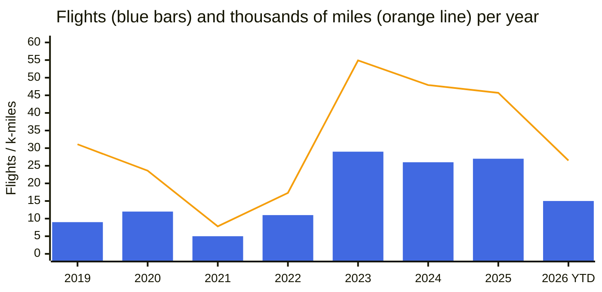
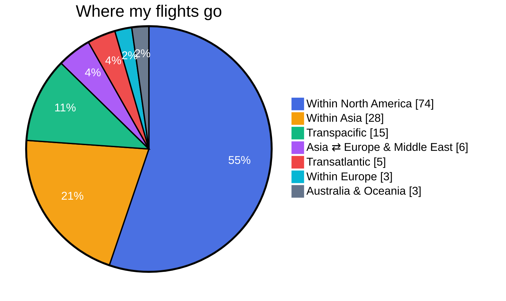
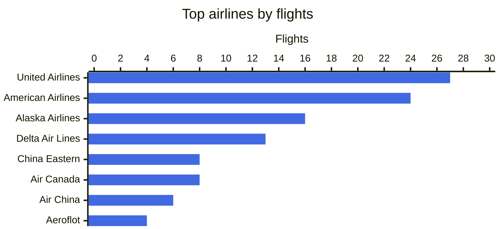
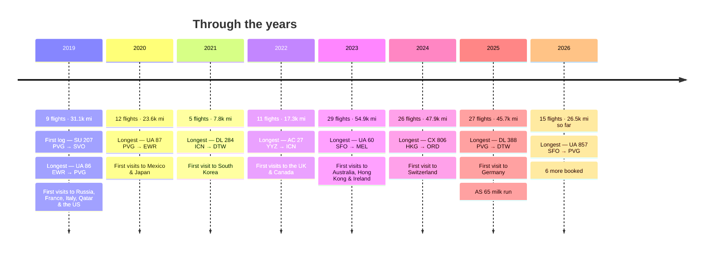

# About Me ✨

<h1 align="center">
  
</h1>

## ✈️ My Aviation Stats & Facts ✈️

| Category | Details |
|----------|---------|
| 🌎 **Current Base** | EWR (Northern NJ) |
| 🏠 **Home Airports** | PVG/SHA (Shanghai) |
| 🧮 **Lifetime** | 134 flights · 254,891 mi · ~599 block hours (≈25 days) |
| ⚡ **Shortest Flight** | AS 65 KTN→WRG · 82 mi (part of the AS 65 milk run) |
| 🛫 **Longest Flight** |  UA 60 SFO→MEL · 7,863 mi · 15h 56m |
| 💺 **Top Airlines** |  United Airlines (27)  American Airlines (24) Alaska Airlines (16)  Delta Air Lines (13) |
| 📍 **Most-Visited Airport** | ORD (Chicago O'Hare) · 32 visits |
| 🔁 **Most-Flown Route** | ORD ⇄ SEA · 6 times |
| 🛩️ **Most-Flown Aircraft** | Boeing 737-800 · 22 flights (29 types in total) |
| ⏱️ **On-Time Arrivals** | 78% within 15 min of schedule |
| 🧭 **Farthest North / South** | ANC (61.2°N) / MEL (37.7°S) |

**Countries visited (16):** 🇦🇺 🇨🇦 🇨🇳 🇫🇷 🇩🇪 🇭🇰 🇮🇪 🇮🇹 🇯🇵 🇲🇽 🇶🇦 🇷🇺 🇰🇷 🇨🇭 🇬🇧 🇺🇸

<b>🛩️ The hangar</b>: every aircraft type I've flown

| Aircraft | Flights |
|----------|--------:|
| Boeing 737-800 | 22 |
| Boeing 777-300 ER | 13 |
| Boeing 737-700 | 11 |
| Embraer 175 | 10 |
| Boeing 737-900ER | 9 |
| Boeing 787-9 | 8 |
| Airbus A321 | 7 |
| Airbus A350-900 | 7 |
| Airbus A320 | 5 |
| Airbus A330-200 | 4 |
| Bombardier CRJ200 | 4 |
| Airbus A321neo | 4 |
| Boeing 737 MAX 9 | 4 |
| Boeing 787-8 | 3 |
| Bombardier CRJ900 | 3 |
| Airbus A330-300 | 3 |
| Boeing 787-10 | 2 |
| Airbus A319 | 2 |
| Airbus A350-1000 | 2 |
| Boeing 737 MAX 8 | 2 |
| Boeing 757-300 | 1 |
| Boeing 767-300 | 1 |
| DHC-8-400 Dash 8Q | 1 |
| Airbus A340-300 | 1 |
| Airbus A330-900neo | 1 |
| Boeing 717-200 | 1 |
| Embraer 170 | 1 |
| Boeing 777-200 ER | 1 |
| Airbus A320neo | 1 |

<b>📍 Airport leaderboard</b>: 64 airports and counting

| # | Airport | City | Visits |
|--:|---------|------|-------:|
| 1 | **ORD** | Chicago 🇺🇸 | 32 |
| 2 | **PVG** | Shanghai 🇨🇳 | 23 |
| 3 | **SEA** | Seattle 🇺🇸 | 20 |
| 4 | **CLE** | Cleveland 🇺🇸 | 19 |
| 5 | **SHA** | Shanghai 🇨🇳 | 15 |
| 6 | **EWR** | Newark 🇺🇸 | 11 |
| 7 | **YVR** | Vancouver 🇨🇦 | 8 |
| 8 | **SFO** | San Francisco 🇺🇸 | 6 |
| 9 | **ICN** | Seoul 🇰🇷 | 5 |
| 10 | **SVO** | Moscow 🇷🇺 | 4 |

Also: ANC · BDL · BNE · BOS · CAN · CDG · CLT · CMH · CTU · DCA · DEN · DFW · DOH · DTW · DUB · FCO · FOC · HAK · HKG · HND · IAD · IAH · JFK · JNU · KMG · KTN · LAS · LGA · LGW · MEL · MEX · MIA · MUC · NKG · NRT · OAK · OGG · OMA · PDX · PEK · PHL · PIT · PKX · RDU · SJU · SLC · SYD · SYX · SZX · TYN · WRG · XNN · YYZ · ZRH

<b>💺 All 24 airlines</b>

| Airline | Flights | Miles |
|---------|--------:|------:|
|  United Airlines (UA) | 27 | 57,300 |
|  American Airlines (AA) | 24 | 30,527 |
| Alaska Airlines (AS) | 16 | 19,092 |
|  Delta Air Lines (DL) | 13 | 31,540 |
| China Eastern (MU) | 8 | 7,468 |
| Air Canada (AC) | 8 | 20,771 |
| Air China (CA) | 6 | 14,338 |
| Aeroflot (SU) | 4 | 11,529 |
| Cathay Pacific (CX) | 4 | 13,907 |
| Qatar Airways (QR) | 2 | 10,729 |
| ANA (NH) | 2 | 8,109 |
| China Southern (CZ) | 2 | 2,283 |
| Virgin Australia (VA) | 2 | 1,326 |
| Aer Lingus (EI) | 2 | 3,758 |
| Juneyao Air (HO) | 2 | 1,892 |
| Shenzhen Airlines (ZH) | 2 | 1,429 |
| SWISS (LX) | 2 | 10,043 |
| Southwest (WN) | 2 | 1,344 |
| WestJet (WS) | 1 | 3,566 |
| Xiamen Air (MF) | 1 | 378 |
| Japan Airlines (JL) | 1 | 1,104 |
| Shanghai Airlines (FM) | 1 | 751 |
| Tibet Airlines (TV) | 1 | 1,015 |
| Spring Airlines (9C) | 1 | 693 |

## 📈 By the Numbers

## 🎲 Flight Deck Trivia

Tap a question to reveal the answer.

<b>🌙 Have I flown far enough to reach the Moon?</b>

Yes.

<b>🐄 What's my longest “milk run”?</b>

**AS 65** on Dec 9, 2025: SEA → KTN → WRG → JNU → ANC in a single day, on the same Boeing 737-700 (N611AS). 

<b>⏱️ Worst delay vs. best early arrival?</b>

Worst: **AA 3329 SFO→ORD** on Dec 21, 2025, 3h 40m late at the gate. Best: **EI 86 CLE→DUB** on Dec 20, 2023, 68 minutes early. Also: 5 cancellations and 1 diversion. Overall, 78% of my flights arrived within 15 minutes of schedule.

<b>🌏 How many continents?</b>

Four so far: North America, Asia, Europe and Oceania. 🇦🇺 Australia 🇨🇦 Canada 🇨🇳 China 🇫🇷 France 🇩🇪 Germany 🇭🇰 Hong Kong 🇮🇪 Ireland 🇮🇹 Italy 🇯🇵 Japan 🇲🇽 Mexico 🇶🇦 Qatar 🇷🇺 Russia 🇰🇷 South Korea 🇨🇭 Switzerland 🇬🇧 United Kingdom 🇺🇸 United States

  <i>Happy flying and blue skies!</i> 🛫 
  Stats from my Flighty log, updated October 21, 2026

